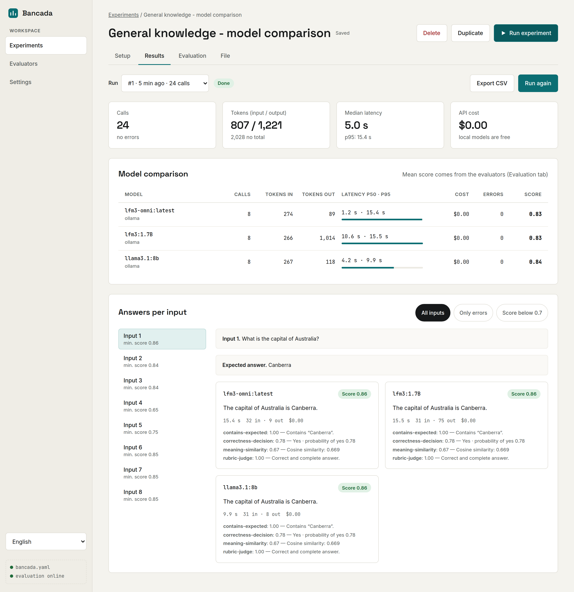
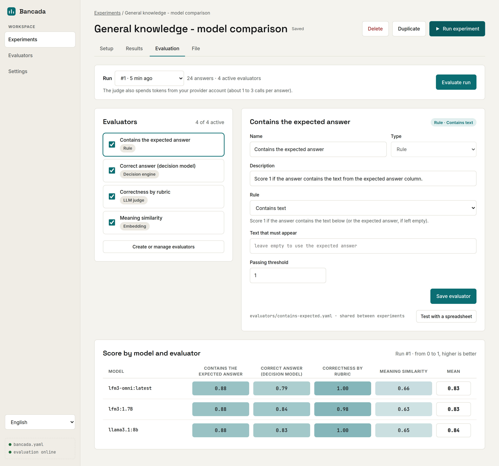
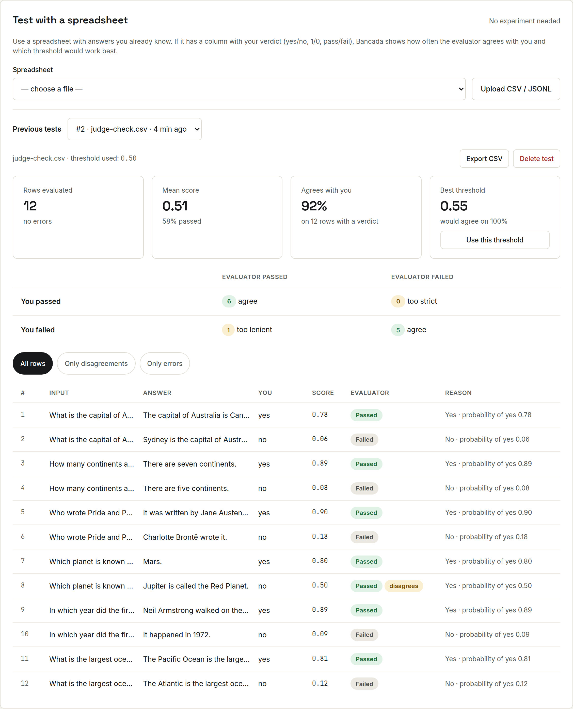
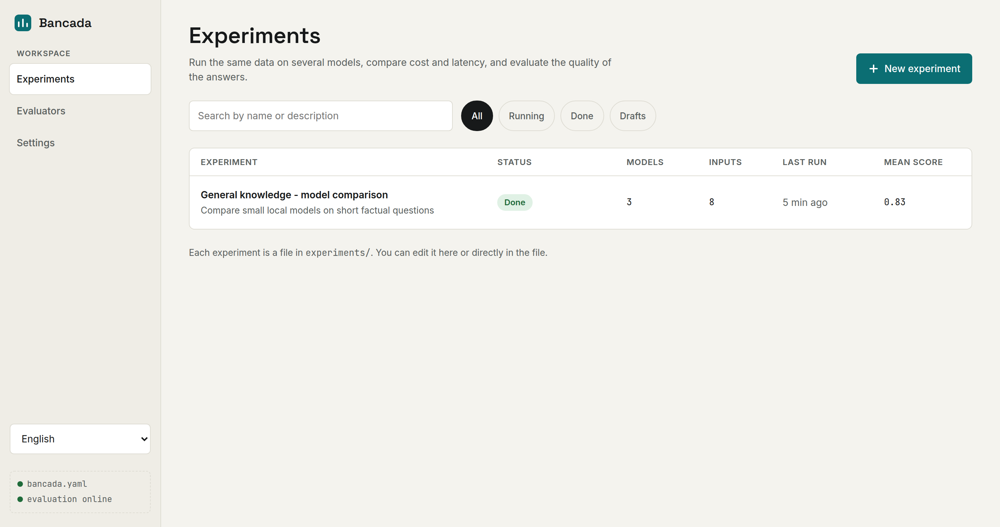
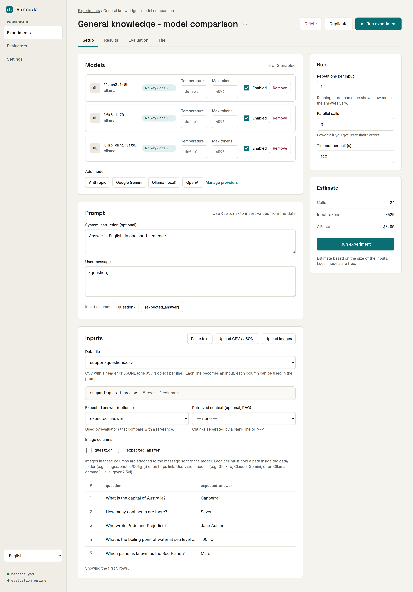
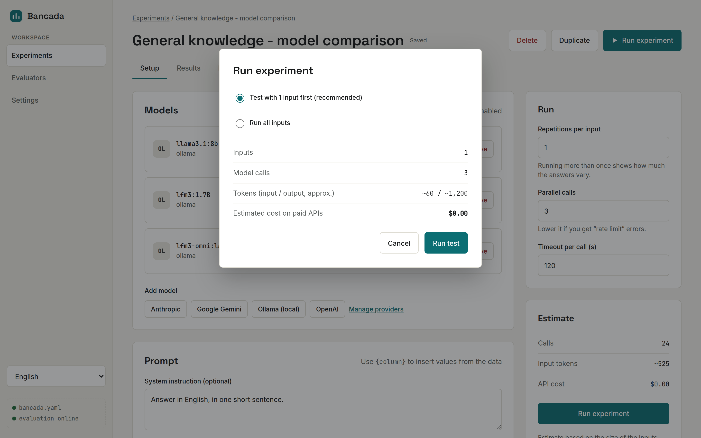
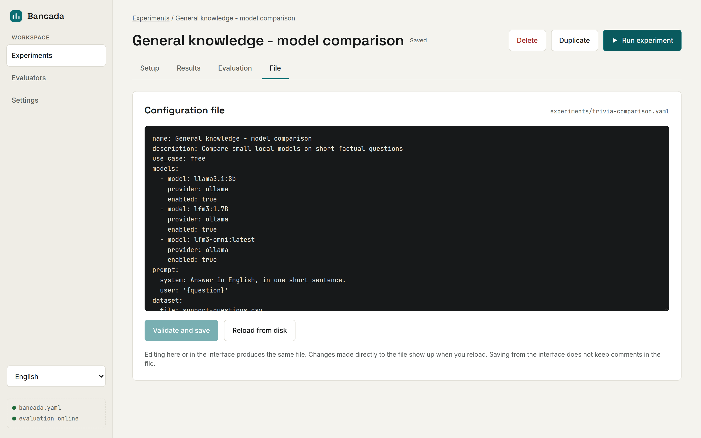
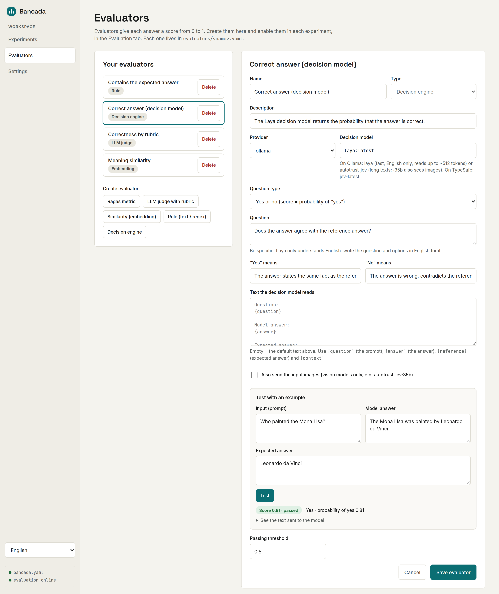
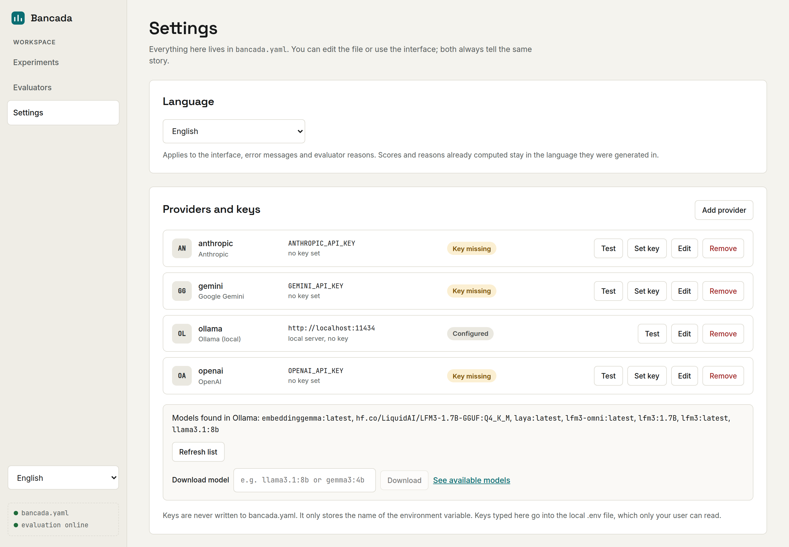

# Bancada

*[Leia em português](README.md)*

A test bench for language models, made for people who don't code. Run the same data through several models (OpenAI, Claude, Gemini, Ollama…), compare tokens, latency and cost, and evaluate the quality of the answers. All from a local web interface.

**What you can do:**

- **Experiments:** a prompt with `{columns}`, a spreadsheet (CSV/JSONL) or images as input, and several models side by side.
- **Results:** answers per input, tokens, latency (p50/p95), estimated cost before and actual cost after, and CSV export.
- **Evaluators:**
  - Ragas-style metrics;
  - LLM judge with a rubric;
  - embedding similarity;
  - rules (text or regex);
  - **decision models** (Laya, JEV), which answer with probabilities.
- **Test evaluators with a spreadsheet:** compares the evaluator's scores with your own verdict and suggests the best threshold.
- **Everything in YAML files**, editable from the interface or by hand, ready to version.
- **Portuguese or English:** switch the language in the corner of the sidebar or in **Settings**.

## Screenshots

**Results:** answers side by side, with tokens, latency and cost for each model.



**Evaluation:** each model's score on each evaluator.



**Testing an evaluator with a spreadsheet:** how often it agrees with you and which threshold works best.



<details>
<summary>More screenshots</summary>

**Experiment list**



**Experiment setup:** models, prompt and data.



**Estimated cost before running**



**The experiment as a YAML file**



**Decision engine, with a quick test on one example**



**Settings:** providers, keys and Ollama models.



</details>

## Step by step for people who have never coded

You don't need to know how to code. You'll install one program (Docker Desktop), download Bancada and type **a single command**. Set aside about 20 minutes the first time and keep at least **10 GB free** on your disk.

### 1. Install Docker Desktop

Docker Desktop is the program that runs Bancada for you, so you don't have to install anything else.

1. Go to https://www.docker.com/products/docker-desktop/ and click **Download** for your system (Windows, Mac or Linux).
   - **Mac:** choose *Apple Silicon* if your Mac is from 2021 or later (M1, M2, M3… chip), or *Intel* if it's older. Not sure? Apple menu  › **About This Mac** shows the chip.
2. Open the downloaded file and follow the installer, accepting the default options.
   - **Windows:** if it asks to install or update "WSL", accept. You may need to restart your computer.
3. Open **Docker Desktop** (from the Start menu on Windows, or the Applications folder on Mac). Accept the terms. You don't need an account: you can skip the sign-in.
4. Wait until it shows **"Engine running"** (or the whale icon in the taskbar stops moving). Leave Docker Desktop open.

### 2. Download Bancada

1. Open the project page on GitHub: https://github.com/marcornv/ai-workstation
2. Click the green **Code** button, then **Download ZIP**.
3. Unzip the downloaded file:
   - **Windows:** right-click the `.zip` › **Extract All…** › **Extract**.
   - **Mac:** double-click the `.zip`.
4. Move the unzipped folder somewhere easy to find, like **Documents**. Inside it you should see files such as `README.md` and `docker-compose.yml`.

### 3. Open a terminal inside the Bancada folder

The terminal is a window where you type commands. You'll only use it for a moment.

- **Windows:** open the Bancada folder in File Explorer. Click the address bar at the top (where the folder path is shown), delete what's there, type `cmd` and press **Enter**. A black window opens, already in the right folder.
- **Mac:** open **Terminal** (press `Cmd + Space`, type `Terminal` and press Enter). Type `cd ` (with a space at the end, don't press Enter yet), **drag the Bancada folder** from Finder into the Terminal window and press **Enter**.
- **Linux:** right-click inside the folder and choose **Open in Terminal**.

### 4. Start Bancada

In the terminal, type (or copy and paste) the command below and press **Enter**:

```
docker compose up -d
```

The first time, Docker downloads and prepares everything. This takes **5 to 15 minutes**, depending on your internet connection; lots of lines of text will scroll by. It's ready when the lines stop and you see something like `Started` or `Running` for `bancada`, `evaluator` and `ollama`.

### 5. Open it in your browser

Open Chrome, Firefox, Edge or Safari and go to **http://localhost:8080**. Done! Now follow [Your first experiment](#your-first-experiment).

You can close the terminal now. Bancada keeps running as long as Docker Desktop is open.

### Next time

- **To use it again:** open Docker Desktop, wait for it to start and go to http://localhost:8080. Bancada starts on its own together with Docker, no need to type the command again.
- **To turn it off:** in Docker Desktop, go to **Containers** and click the stop button (■) next to `bancada`. Or simply quit Docker Desktop.
- **To turn it back on after stopping it with the button:** click ▶ in the same place, or repeat steps 3 and 4.
- **Your experiments and results** live in the `bancada-data` folder, inside the Bancada folder. Don't delete it.

### If something goes wrong

| What you see | What to do |
|---|---|
| `'docker' is not recognized…` or `command not found: docker` | Docker Desktop isn't installed or hasn't finished installing. Install it (step 1), close the terminal and open it again. |
| `Cannot connect to the Docker daemon` or `error during connect` | Docker Desktop is closed or still starting. Open it, wait for "Engine running" and run the command again. |
| `no configuration file provided: not found` | The terminal isn't in the Bancada folder. Redo step 3, making sure it's the folder that has `docker-compose.yml`. |
| `port is already allocated` | Another program is using port 8080. Close it, or restart your computer and try again. |
| The page doesn't open in the browser | Wait another minute and reload. In Docker Desktop, under **Containers**, check that `bancada` is running (green dot). |
| Running out of disk space | Local Ollama models are large. To delete all of them, run `docker compose down -v` in the Bancada folder (your experiments in `bancada-data` are kept), then `docker compose up -d`. |

### To update Bancada

Download the new ZIP (step 2), copy your old `bancada-data` folder into the new folder and run `docker compose up -d --build` inside the new folder (steps 3 and 4).

## Running with Docker (easiest)

All you need is [Docker Desktop](https://www.docker.com/products/docker-desktop/). It already includes Bancada, the evaluation service and Ollama (local models).

```bash
docker compose up -d      # the first time takes a few minutes
```

Open http://localhost:8080. To stop: `docker compose down`. Your data stays saved.

- **Your files** live in the `bancada-data/` folder, created next to this README: settings, experiments, evaluators, data, images, results and keys (`.env`). It's a normal folder that you can open, copy as a backup or version.
- **Local models:** in **Settings › Ollama › Download model**, type the name (e.g. `llama3.1:8b`, or `gemma3:4b` for images) and click Download. Models are stored in the `ollama-models` Docker volume. To delete them: `docker compose down -v`.
- **NVIDIA graphics card:** uncomment the `deploy` block of the `ollama` service in `docker-compose.yml`. Local models get much faster.
- **Linux:** files in `bancada-data/` belong to user 1000. If yours is different (`id -u`), run `BANCADA_UID=$(id -u) BANCADA_GID=$(id -g) docker compose up -d`.
- For security, the port is only open to your own computer (`127.0.0.1`).

## Running without Docker

1. Install once:
   - [Go](https://go.dev/dl/) 1.25 or newer;
   - [Node.js](https://nodejs.org/) 20 or newer;
   - [Python](https://www.python.org/downloads/) 3.10 or newer;
   - for free local models, [Ollama](https://ollama.com).
2. Open Bancada:
   - **Linux / macOS:** run `./start.sh` in the terminal.
   - **Windows:** double-click `start.bat`.
3. Open http://127.0.0.1:8080 in your browser. The first time takes a few minutes because Bancada prepares everything.

To close it, close the terminal window (or press `Ctrl+C`).

## Your first experiment

1. In **Settings**, click **Set key** on the provider you'll use. If you'll only use Ollama, you don't need a key.
2. In **Experiments**, open *Example - general questions* (or its Portuguese version, *Exemplo - perguntas gerais*) or create a new one. The example uses the Ollama models `lfm3-omni` and `lfm3:1.7B`: download them in **Settings › Download model**, or swap them for others in the **Setup** tab.
3. In the **Setup** tab, choose the models, write the prompt (use `{column}` to insert data) and upload a CSV, JSONL or images.
4. Click **Run experiment**. Bancada shows the estimated cost before spending anything, and suggests testing with 1 input first.
5. See answers, tokens, latency and cost in the **Results** tab. In the **Evaluation** tab, turn on evaluators and click **Evaluate run**.

## Evaluators

Evaluators give each answer a score from 0 to 1. Create them in **Evaluators** and turn them on per experiment, in the **Evaluation** tab.

| Type | How it judges | Needs |
|---|---|---|
| Ragas | Faithfulness, answer relevancy or context precision | Judge model (and embedding for relevancy) |
| LLM judge | A model scores following a rubric you write | Judge model |
| Embedding | Similarity in meaning to the expected answer | Embedding model |
| Rule | Equals the reference, contains a text or matches a regex | Nothing (free) |
| Decision engine | A decision model answers with probabilities | Decision model (Laya, JEV) |

Bancada comes with three example evaluators, in English and in Portuguese:

- **Contains the expected answer** (rule): works right away, no key or model needed.
- **Rubric grading** (LLM judge): uses Ollama's `lfm3-omni`, the same model as the example experiment. Once you've downloaded it, no key is needed.
- **Faithfulness** (Ragas): uses Claude as the judge, so it needs an Anthropic key. Without one, change the judge model in **Evaluators**.

### Decision engine (Laya, JEV)

A **decision model** doesn't generate text: it reads the answer and returns probabilities. It's fast and gives consistent numbers.

1. Download a model in **Settings › Ollama › Download model**:
   - `laya` (~850 MB): very fast, but only understands English and reads up to ~512 tokens.
   - `autotrust-jev` (~11 GB): accepts long texts.
   - `autotrust-jev:35b`: also sees images.

   For TypeSafe's hosted Jev, add a provider of type **TypeSafe** with your key.
2. In **Evaluators › Decision engine**, choose the question type. Each one's score is:
   - **Yes or no:** the probability of "yes".
   - **Choice between options:** the sum of the probabilities of the options marked as passing.
   - **Rating levels:** the expected level divided by the top level.
3. Use **Test with an example** to fine-tune the question before evaluating a whole experiment.

Decision evaluators work even without the Python service. Thresholds don't carry over from one model to another, so readjust them when you switch models.

### Testing an evaluator with a spreadsheet

You don't need to run an experiment to know whether an evaluator is good. In **Evaluators**, open a saved evaluator and use **Test with a spreadsheet**:

1. Choose or upload a CSV/JSONL with the answers to judge (see the example `data/example-validator.csv`).
2. Pick the columns. The answer is required; the rest is optional: input, expected answer, context, images and **your verdict** (yes/no, 1/0, pass/fail or a score from 0 to 1).
3. Click **Run test**.

With a verdict column, Bancada shows:
- how much the evaluator agrees with you;
- where it gets it wrong, and whether it's too lenient or too strict;
- the **best threshold**, with a button to apply it.

Each test is saved, so you can compare after tweaking the evaluator, and can be exported as CSV.

## Images

Experiments can send images along with the prompt, for example to describe photos, read receipts or classify images.

- **Easiest way:** in **Inputs › Upload images**, choose several images at once. Each image becomes an input, in the `imagem` column.
- **Labeling images:** right after the upload, a window shows every image with a box for its label (e.g. the right class). Saving turns that column into the **expected answer**, so evaluators such as *Contains the expected answer* compare the model's answer with your label. To change the labels later, use **Label images** above the data preview.
- **With a spreadsheet:** put the images inside `data/` (e.g. `data/images/photos/001.jpg`) and create a CSV with a column holding the path relative to `data/` (`images/photos/001.jpg`) or an `https://…` link. Then select that column under **Image columns**.
- Formats: PNG, JPEG, GIF and WEBP, up to 20 MB each.
- Use vision models such as GPT-4o, Claude, Gemini or, on Ollama, `gemma3`, `llava` and `qwen2.5vl`. Models without vision will error out or ignore the image.
- Evaluators only look at text (prompt, answer and reference), not the image. The exceptions are the **LLM judge** and the **Decision engine** with "Also send the input images" turned on. Both need a judge or decision model with vision. The LLM judge works with any provider; the Decision engine only through Ollama.

## Where everything lives

| What | Where |
|---|---|
| General settings (providers, prices, default judge) | `bancada.yaml` (created the first time Bancada starts) |
| Experiments | `experiments/<name>.yaml` |
| Evaluators | `evaluators/<name>.yaml` |
| Data uploaded in an experiment (CSV / JSONL / images) | `data/<experiment>/` (images in `data/<experiment>/images/`) |
| Shared data | directly in `data/` |
| Run and test results | `data/bancada.db` (SQLite) |
| API keys | `.env` |

Files uploaded from an experiment's **Setup** tab belong to that experiment. They're listed first in **Data file**, can be deleted with the **Delete** button next to it, and are deleted along with the experiment. Duplicating an experiment copies its folder. Files you put directly in `data/` are shared: every experiment can use them and Bancada never deletes them. Images uploaded before this change stay in `data/images/` and remain shared.

With Docker, all of this lives inside `bancada-data/`.

The files are the source of truth. The interface reads the disk on every load and writes to it on every change, so you can edit either way.

## Language

The interface, error messages and evaluator reasons are available in Portuguese and English. Switch with the selector in the sidebar or in **Settings › Language**. The choice is saved in `bancada.yaml` (`language: pt-BR` or `language: en`). Scores and reasons already computed stay in the language they were generated in.

## Security

- Bancada only accepts connections from your own computer (127.0.0.1).
- API keys live in the `.env` file, which only your user can read. `bancada.yaml` only stores the variable's *name*. Neither goes into Git.
- Nothing runs on paid APIs without you seeing the cost estimate and confirming.
- Uploaded data files never overwrite others: a repeated name gets a `-2`, `-3`… suffix.
- Found a security problem? Please report it privately, as described in [SECURITY.md](SECURITY.md).

## Contributing

Bug reports, ideas and pull requests are welcome, in English or Portuguese. You don't need to code to help: reporting what confused you during installation is just as useful. See [CONTRIBUTING.md](CONTRIBUTING.md).

## For developers

See the [Developer notes](README.md#developer-notes-english) (in English) in the main README: project layout, backend files, Docker, images, decision models and `make` commands.

## License

[MIT](LICENSE)
