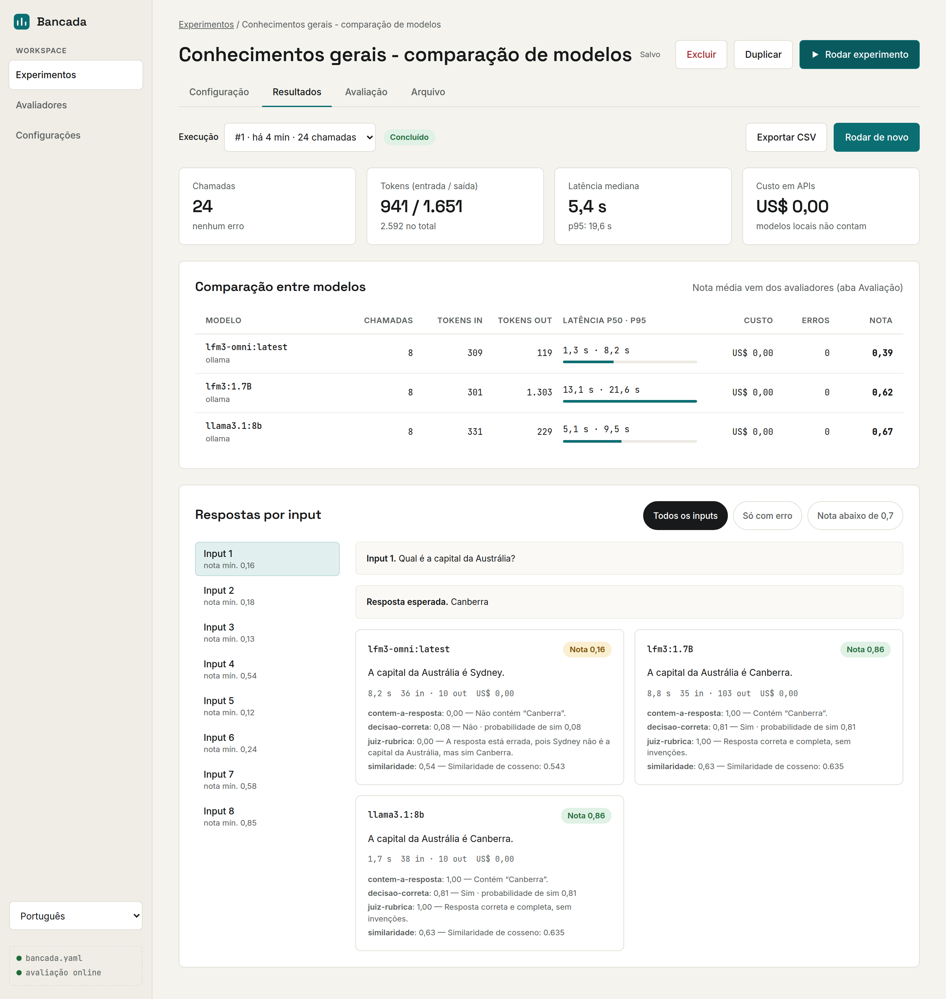
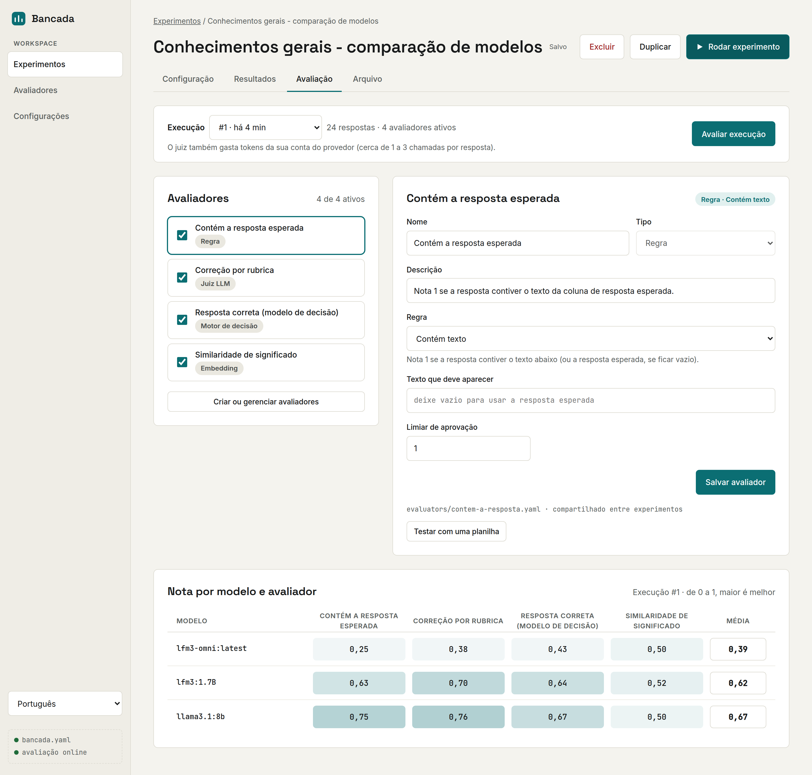
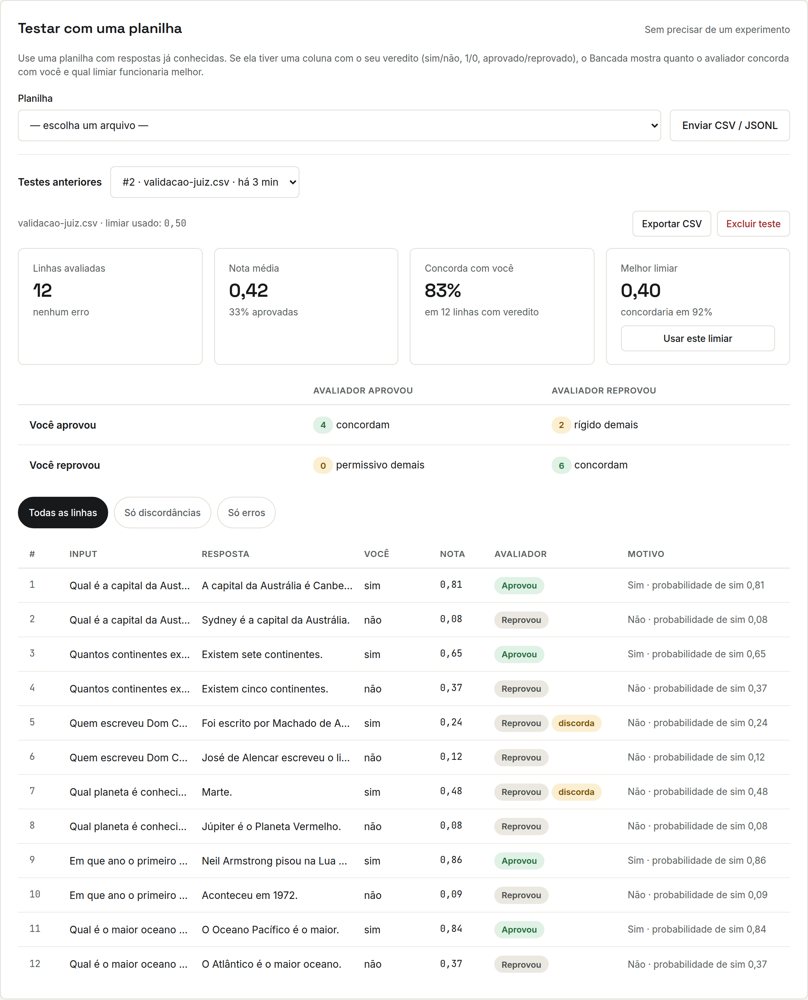
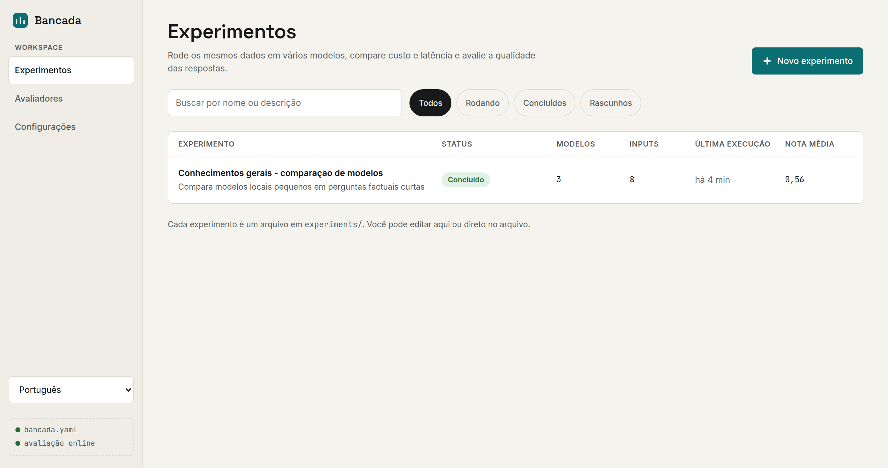
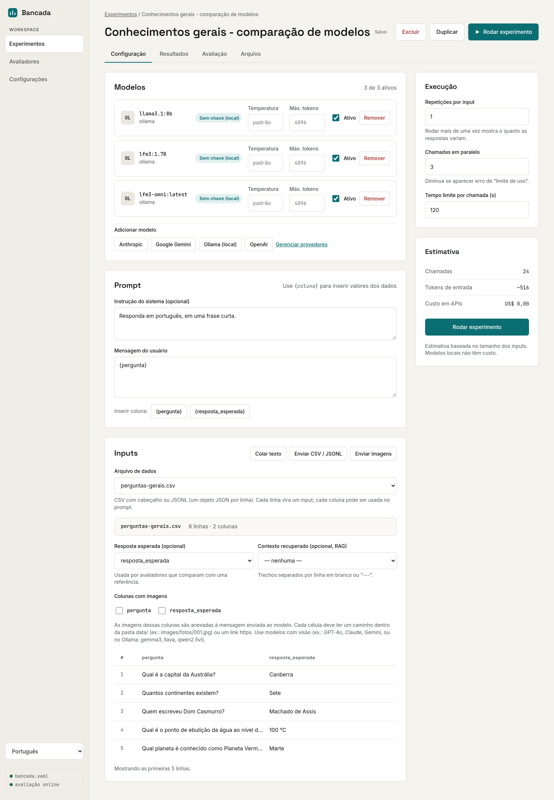
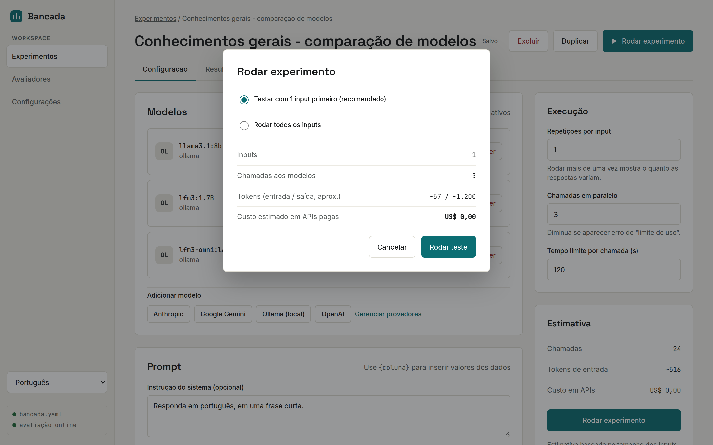
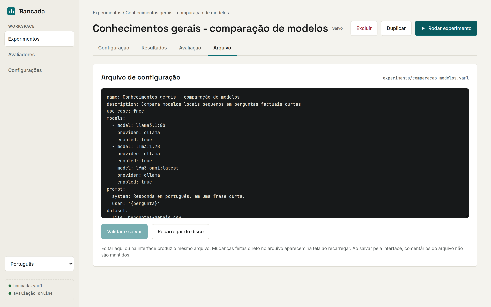
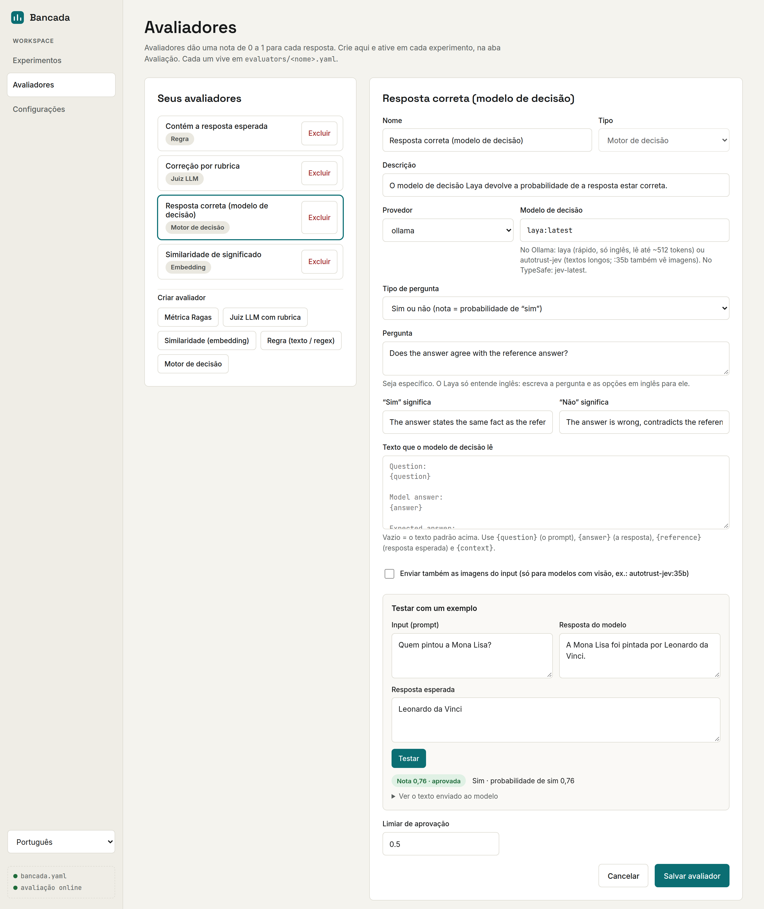
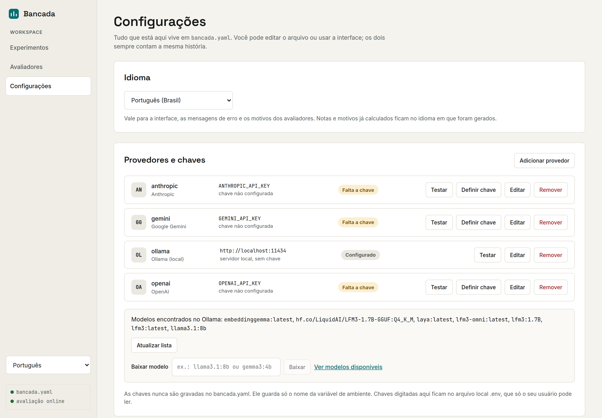

# Bancada

*[Read in English](README.en.md)*

Uma bancada de testes para modelos de linguagem, feita para quem não programa. Rode os mesmos dados em vários modelos (OpenAI, Claude, Gemini, Ollama…), compare tokens, latência e custo, e avalie a qualidade das respostas. Tudo por uma interface web local.

**O que dá para fazer:**

- **Experimentos:** um prompt com `{colunas}`, uma planilha (CSV/JSONL) ou imagens como entrada, e vários modelos lado a lado.
- **Resultados:** respostas por input, tokens, latência (p50/p95), custo estimado antes e custo real depois, e exportação em CSV.
- **Avaliadores:**
  - métricas no estilo Ragas;
  - juiz LLM com rubrica;
  - similaridade por embeddings;
  - regras (texto ou regex);
  - **modelos de decisão** (Laya, JEV), que respondem com probabilidades.
- **Testar avaliadores com uma planilha:** compara as notas do avaliador com o seu veredito e sugere o melhor limiar.
- **Tudo em arquivos YAML** editáveis pela interface ou à mão, prontos para versionar.
- **Português ou inglês:** troque o idioma no canto da barra lateral ou em **Configurações**.

## Telas

**Resultados:** respostas lado a lado, tokens, latência e custo de cada modelo.



**Avaliação:** a nota de cada modelo em cada avaliador.



**Testar um avaliador com uma planilha:** quanto ele concorda com você e qual limiar funciona melhor.



<details>
<summary>Mais telas</summary>

**Lista de experimentos**



**Configuração do experimento:** modelos, prompt e dados.



**Custo estimado antes de rodar**



**O experimento como arquivo YAML**



**Motor de decisão, com teste rápido de um exemplo**



**Configurações:** provedores, chaves e modelos do Ollama.



</details>

## Passo a passo para quem nunca programou

Não precisa saber programar. Você vai instalar um programa (o Docker Desktop), baixar o Bancada e digitar **um único comando**. Separe uns 20 minutos para a primeira vez e deixe pelo menos **10 GB livres** no disco.

### 1. Instale o Docker Desktop

O Docker Desktop é o programa que roda o Bancada para você, sem precisar instalar mais nada.

1. Entre em https://www.docker.com/products/docker-desktop/ e clique em **Download** para o seu sistema (Windows, Mac ou Linux).
   - **Mac:** escolha *Apple Silicon* se o seu Mac for de 2021 em diante (chip M1, M2, M3…), ou *Intel* se for mais antigo. Na dúvida: menu  › **Sobre Este Mac** mostra o chip.
2. Abra o arquivo baixado e siga o instalador, aceitando as opções padrão.
   - **Windows:** se ele pedir para instalar ou atualizar o "WSL", aceite. Talvez seja preciso reiniciar o computador.
3. Abra o **Docker Desktop** (pelo menu Iniciar no Windows, ou pela pasta Aplicativos no Mac). Aceite os termos. Não precisa criar conta: dá para pular o login.
4. Espere até aparecer **"Engine running"** (ou a baleia na barra de tarefas ficar parada). Deixe o Docker Desktop aberto.

### 2. Baixe o Bancada

1. Abra a página do projeto no GitHub: https://github.com/marcornv/ai-workstation
2. Clique no botão verde **Code** e depois em **Download ZIP**.
3. Descompacte o arquivo baixado:
   - **Windows:** clique com o botão direito no `.zip` › **Extrair tudo…** › **Extrair**.
   - **Mac:** dê dois cliques no `.zip`.
4. Mova a pasta descompactada para um lugar fácil de achar, como **Documentos**. Dentro dela você deve ver arquivos como `README.md` e `docker-compose.yml`.

### 3. Abra o terminal dentro da pasta do Bancada

O terminal é uma janela onde você digita comandos. Você só vai usar ele por um instante.

- **Windows:** abra a pasta do Bancada no Explorador de Arquivos. Clique na barra de endereço lá em cima (onde aparece o caminho da pasta), apague o que estiver escrito, digite `cmd` e aperte **Enter**. Uma janela preta vai abrir, já na pasta certa.
- **Mac:** abra o **Terminal** (aperte `Cmd + Espaço`, digite `Terminal` e aperte Enter). Digite `cd ` (com um espaço no final, sem apertar Enter), **arraste a pasta do Bancada** do Finder para dentro da janela do Terminal e aperte **Enter**.
- **Linux:** clique com o botão direito dentro da pasta e escolha **Abrir no terminal**.

### 4. Ligue o Bancada

No terminal, digite (ou copie e cole) o comando abaixo e aperte **Enter**:

```
docker compose up -d
```

Na primeira vez, o Docker baixa e prepara tudo. Isso leva de **5 a 15 minutos**, dependendo da sua internet; vão aparecer várias linhas de texto. Está pronto quando as linhas pararem e aparecer algo como `Started` ou `Running` para `bancada`, `evaluator` e `ollama`.

### 5. Abra no navegador

Abra o Chrome, Firefox, Edge ou Safari e entre em **http://localhost:8080**. Pronto! Agora siga o [Primeiro experimento](#primeiro-experimento).

Você já pode fechar o terminal. O Bancada continua funcionando enquanto o Docker Desktop estiver aberto.

### Nas próximas vezes

- **Para usar de novo:** abra o Docker Desktop, espere ele ligar e entre em http://localhost:8080. O Bancada liga sozinho junto com o Docker, sem precisar digitar o comando de novo.
- **Para desligar:** no Docker Desktop, vá em **Containers** e clique no botão de parar (■) ao lado de `bancada`. Ou simplesmente feche o Docker Desktop.
- **Para ligar depois de desligar pelo botão:** clique em ▶ no mesmo lugar, ou repita os passos 3 e 4.
- **Seus experimentos e resultados** ficam na pasta `bancada-data`, dentro da pasta do Bancada. Não apague essa pasta.

### Se algo der errado

| O que aparece | O que fazer |
|---|---|
| `'docker' não é reconhecido…` ou `command not found: docker` | O Docker Desktop não está instalado ou ainda não terminou de instalar. Instale (passo 1), feche o terminal e abra de novo. |
| `Cannot connect to the Docker daemon` ou `error during connect` | O Docker Desktop está fechado ou ainda ligando. Abra ele, espere aparecer "Engine running" e rode o comando de novo. |
| `no configuration file provided: not found` | O terminal não está na pasta do Bancada. Refaça o passo 3, garantindo que é a pasta que tem o `docker-compose.yml`. |
| `port is already allocated` | Outro programa está usando a porta 8080. Feche-o ou reinicie o computador e tente de novo. |
| A página não abre no navegador | Espere mais um minuto e recarregue. Confira no Docker Desktop, em **Containers**, se o `bancada` está ligado (bolinha verde). |
| Ficou sem espaço no disco | Os modelos locais do Ollama são grandes. Para apagar todos, rode `docker compose down -v` na pasta do Bancada (seus experimentos em `bancada-data` continuam guardados) e depois `docker compose up -d`. |

### Para atualizar o Bancada

Baixe o ZIP novo (passo 2), copie a sua pasta `bancada-data` antiga para dentro da pasta nova e rode `docker compose up -d --build` dentro da pasta nova (passos 3 e 4).

## Como abrir com Docker (mais fácil)

Só precisa do [Docker Desktop](https://www.docker.com/products/docker-desktop/). Ele já traz o Bancada, o serviço de avaliação e o Ollama (modelos locais).

```bash
docker compose up -d      # a primeira vez demora alguns minutos
```

Abra http://localhost:8080. Para parar: `docker compose down`. Seus dados continuam guardados.

- **Seus arquivos** ficam na pasta `bancada-data/`, criada ao lado deste README: configuração, experimentos, avaliadores, dados, imagens, resultados e chaves (`.env`). É uma pasta normal, que você pode abrir, copiar como backup ou versionar.
- **Modelos locais:** em **Configurações › Ollama › Baixar modelo**, digite o nome (ex.: `llama3.1:8b`, ou `gemma3:4b` para imagens) e clique em Baixar. Os modelos ficam no volume do Docker `ollama-models`. Para apagá-los: `docker compose down -v`.
- **Placa de vídeo NVIDIA:** descomente o bloco `deploy` do serviço `ollama` em `docker-compose.yml`. Os modelos locais ficam muito mais rápidos.
- **Linux:** os arquivos em `bancada-data/` pertencem ao usuário 1000. Se o seu for outro (`id -u`), rode `BANCADA_UID=$(id -u) BANCADA_GID=$(id -g) docker compose up -d`.
- Por segurança, a porta só é aberta para o seu computador (`127.0.0.1`).

## Como abrir sem Docker

1. Instale uma vez:
   - [Go](https://go.dev/dl/) 1.25 ou mais novo;
   - [Node.js](https://nodejs.org/) 20 ou mais novo;
   - [Python](https://www.python.org/downloads/) 3.10 ou mais novo;
   - para modelos locais e gratuitos, o [Ollama](https://ollama.com).
2. Abra o Bancada:
   - **Linux / macOS:** rode `./start.sh` no terminal.
   - **Windows:** dê dois cliques em `start.bat`.
3. O navegador abre em http://127.0.0.1:8080. A primeira vez demora alguns minutos porque o Bancada prepara tudo.

Para fechar, feche a janela do terminal (ou aperte `Ctrl+C`).

## Primeiro experimento

1. Em **Configurações**, clique em **Definir chave** no provedor que você vai usar. Se for usar só o Ollama, não precisa de chave.
2. Em **Experimentos**, abra o *Exemplo - perguntas gerais* ou crie um novo. O exemplo usa os modelos `lfm3-omni` e `lfm3:1.7B` do Ollama: baixe-os em **Configurações › Baixar modelo**, ou troque por outros na aba **Configuração**.
3. Na aba **Configuração**, escolha os modelos, escreva o prompt (use `{coluna}` para inserir dados) e envie um CSV, JSONL ou imagens.
4. Clique em **Rodar experimento**. O Bancada mostra o custo estimado antes de gastar qualquer coisa, e sugere testar com 1 input primeiro.
5. Veja respostas, tokens, latência e custo na aba **Resultados**. Na aba **Avaliação**, ative avaliadores e clique em **Avaliar execução**.

## Avaliadores

Avaliadores dão uma nota de 0 a 1 para cada resposta. Crie em **Avaliadores** e ative em cada experimento, na aba **Avaliação**.

| Tipo | Como julga | Precisa de |
|---|---|---|
| Ragas | Fidelidade, relevância da resposta ou precisão do contexto | Modelo juiz (e embedding para relevância) |
| Juiz LLM | Um modelo dá a nota seguindo uma rubrica escrita por você | Modelo juiz |
| Embedding | Similaridade de significado com a resposta esperada | Modelo de embedding |
| Regra | Igual à referência, contém um texto ou casa com uma regex | Nada (sem custo) |
| Motor de decisão | Um modelo de decisão responde com probabilidades | Modelo de decisão (Laya, JEV) |

O Bancada já vem com três avaliadores de exemplo, em português e em inglês:

- **Contém a resposta esperada** (regra): funciona na hora, sem chave nem modelo.
- **Correção por rubrica** (juiz LLM): usa o `lfm3-omni` do Ollama, o mesmo modelo do experimento de exemplo. Baixando ele, não precisa de chave.
- **Fidelidade** (Ragas): usa o Claude como juiz, então precisa de uma chave da Anthropic. Sem chave, troque o modelo juiz em **Avaliadores**.

### Motor de decisão (Laya, JEV)

Um **modelo de decisão** não gera texto: lê a resposta e devolve probabilidades. É rápido e dá números consistentes.

1. Baixe um modelo em **Configurações › Ollama › Baixar modelo**:
   - `laya` (~850 MB): muito rápido, mas só entende inglês e lê até ~512 tokens.
   - `autotrust-jev` (~11 GB): aceita textos longos.
   - `autotrust-jev:35b`: também vê imagens.

   Para o Jev hospedado da TypeSafe, adicione um provedor do tipo **TypeSafe** com a sua chave.
2. Em **Avaliadores › Motor de decisão**, escolha o tipo de pergunta. A nota de cada uma é:
   - **Sim ou não:** a probabilidade de "sim".
   - **Escolha entre opções:** a soma das probabilidades das opções marcadas como aprovadas.
   - **Nota em níveis:** o nível esperado dividido pelo nível máximo.
3. Use **Testar com um exemplo** para ajustar a pergunta antes de avaliar um experimento inteiro.

Avaliadores de decisão funcionam mesmo sem o serviço Python. Limiares não valem de um modelo para outro, então reajuste ao trocar de modelo.

### Testar um avaliador com uma planilha

Você não precisa rodar um experimento para saber se um avaliador é bom. Em **Avaliadores**, abra um avaliador salvo e use **Testar com uma planilha**:

1. Escolha ou envie um CSV/JSONL com as respostas a julgar (veja o exemplo `data/exemplo-validador.csv`).
2. Indique as colunas. A resposta é obrigatória; o resto é opcional: input, resposta esperada, contexto, imagens e **o seu veredito** (sim/não, 1/0, aprovado/reprovado ou uma nota de 0 a 1).
3. Clique em **Rodar teste**.

Com uma coluna de veredito, o Bancada mostra:
- quanto o avaliador concorda com você;
- onde ele erra, se é permissivo ou rígido demais;
- o **melhor limiar**, com um botão para aplicá-lo.

Cada teste fica guardado, para comparar depois de ajustar o avaliador, e pode ser exportado em CSV.

## Imagens

Experimentos podem enviar imagens junto com o prompt, por exemplo para descrever fotos, ler notas fiscais ou classificar imagens.

- **Jeito mais fácil:** em **Inputs › Enviar imagens**, escolha várias imagens de uma vez. Cada imagem vira um input, na coluna `imagem`.
- **Rotulando imagens:** logo depois do envio, uma janela mostra cada imagem com um campo para o rótulo (ex.: a classe certa). Ao salvar, essa coluna vira a **resposta esperada**, e avaliadores como *Contém a resposta esperada* comparam a resposta do modelo com o seu rótulo. Para mudar os rótulos depois, use **Rotular imagens** acima da prévia dos dados.
- **Com uma planilha:** coloque as imagens dentro de `data/` (ex.: `data/images/fotos/001.jpg`) e crie um CSV com uma coluna contendo o caminho a partir de `data/` (`images/fotos/001.jpg`) ou um link `https://…`. Depois marque essa coluna em **Colunas com imagens**.
- Formatos: PNG, JPEG, GIF e WEBP, até 20 MB cada.
- Use modelos com visão, como GPT-4o, Claude, Gemini ou, no Ollama, `gemma3`, `llava` e `qwen2.5vl`. Modelos sem visão vão dar erro ou ignorar a imagem.
- Os avaliadores olham só o texto (prompt, resposta e referência), não a imagem. As exceções são o **Juiz LLM** e o **Motor de decisão** com "Enviar também as imagens" ligado. Os dois precisam de um modelo juiz ou de decisão com visão. O Juiz LLM funciona com qualquer provedor; o Motor de decisão, só pelo Ollama.

## Onde fica cada coisa

| O quê | Onde |
|---|---|
| Configuração geral (provedores, preços, juiz padrão) | `bancada.yaml` (criado na primeira vez que o Bancada abre) |
| Experimentos | `experiments/<nome>.yaml` |
| Avaliadores | `evaluators/<nome>.yaml` |
| Dados enviados em um experimento (CSV / JSONL / imagens) | `data/<experimento>/` (imagens em `data/<experimento>/images/`) |
| Dados compartilhados | direto em `data/` |
| Resultados das execuções e testes | `data/bancada.db` (SQLite) |
| Chaves de API | `.env` |

Arquivos enviados pela aba **Configuração** de um experimento pertencem a ele. Aparecem primeiro em **Arquivo de dados**, podem ser apagados pelo botão **Excluir** ao lado e são apagados junto com o experimento. Duplicar um experimento copia a pasta dele. Arquivos colocados direto em `data/` são compartilhados: todos os experimentos podem usar e o Bancada nunca apaga. Imagens enviadas antes dessa mudança continuam em `data/images/` e seguem compartilhadas.

Com Docker, tudo isso fica dentro de `bancada-data/`.

Os arquivos são a fonte da verdade. A interface lê o disco a cada carregamento e grava nele a cada mudança, então você pode editar por qualquer um dos dois caminhos.

## Idioma / Language

A interface, as mensagens de erro e os motivos dos avaliadores existem em português e inglês. Troque pelo seletor na barra lateral ou em **Configurações › Idioma**. A escolha fica no `bancada.yaml` (`language: pt-BR` ou `language: en`). Notas e motivos já calculados ficam no idioma em que foram gerados.

*The interface, error messages and evaluator reasons are available in Portuguese and English. Switch with the selector in the sidebar or in Settings › Language. The choice is saved in `bancada.yaml` (`language: en`).*

## Segurança

- O Bancada só aceita conexões do seu próprio computador (127.0.0.1).
- As chaves de API ficam no arquivo `.env`, que só o seu usuário pode ler. O `bancada.yaml` guarda apenas o *nome* da variável. Nenhum dos dois vai para o Git.
- Nada roda em APIs pagas sem você ver a estimativa de custo e confirmar.
- Arquivos de dados enviados nunca sobrescrevem outros: um nome repetido ganha um sufixo `-2`, `-3`…
- Encontrou uma falha de segurança? Relate de forma privada, como explicado em [SECURITY.md](SECURITY.md).

## Como contribuir

Relatos de problemas, ideias e pull requests são bem-vindos, em português ou inglês. Não precisa programar para ajudar: contar o que ficou confuso na instalação já ajuda muito. Veja [CONTRIBUTING.md](CONTRIBUTING.md).

---

## Developer notes (English)

### Project layout

```
backend/      Go HTTP server: API, embedded UI, LLM calls, runs, SQLite storage
frontend/     React + Vite + TypeScript (UI text in Portuguese); builds into backend/web/dist
evaluator/    Python FastAPI service: Ragas-style metrics, LLM judge, embeddings, rules
experiments/  example experiment (YAML)
evaluators/   example evaluators (YAML)
data/         example datasets (CSV)
docker/       container entrypoint
.github/      CI workflow
```

The Go binary starts the Python service as a child process when `evaluator/.venv` exists, and stops it on exit. Without Python, everything except Python-based evaluation keeps working.

Code and comments are in English. Everything the user sees exists in Portuguese (pt-BR) and English, written in place with both versions side by side:

- frontend: `t("Salvar", "Save")` (`frontend/src/i18n.ts`);
- Go: `tr("arquivo não encontrado", "file not found")` (`backend/i18n.go`);
- Python: `tr(...)` (`evaluator/i18n.py`).

The language comes from `bancada.yaml → language`. The Go server writes it into the page as `<html lang="...">`, so the frontend knows it before rendering. Go passes it to the Python service with each request. Changing it reloads the page.

### Backend files

The backend is one Go package with one file per topic. There are no layers: handlers read the YAML files and the database directly.

| File | What it does |
|---|---|
| `main.go` | startup: config, database, evaluator process, HTTP server |
| `i18n.go` | the language setting and `tr(pt, en)` |
| `server.go` | every HTTP route and handler |
| `config.go` | YAML structs and load/save for `bancada.yaml`, experiments, evaluators |
| `keys.go` | API keys via env vars and the local `.env` file |
| `dataset.go` | CSV/JSONL parsing, `{column}` template filling |
| `images.go` | image inputs: safe paths, loading files/URLs, type detection |
| `experiment_data.go` | each experiment's own data folder (`data/<id>/`): listing, deleting, copying on duplicate |
| `providers.go` | one plain-HTTP function per provider (OpenAI, Anthropic, Gemini, Ollama) |
| `runner.go` | runs an experiment with a goroutine worker pool |
| `stats.go` | cost, estimates, p50/p95 summaries |
| `evaluation.go` | scores answers: decision evaluators in Go, the rest via the Python service |
| `decisions.go` | decision models (`POST /v1/systemone`: Laya/JEV on Ollama, TypeSafe Jev) and how answers become 0–1 scores |
| `evaluator_tests.go` | running one evaluator over a spreadsheet, agreement with human verdicts, best-threshold search |
| `store.go` | SQLite schema and queries (runs, results, scores, evaluator tests) |

**Evaluator files:**
- `main.py`: the FastAPI endpoint.
- `metrics.py`: each metric as a function.
- `llm.py`: minimal judge and embedding clients.
- `i18n.py`: the request's language and `tr(pt, en)`.

The three Ragas metrics (faithfulness, answer relevancy, context precision) follow the Ragas method but are implemented directly in `metrics.py`. That avoids Ragas/LangChain version churn and lets them work with any judge model.

### Docker

`docker-compose.yml` runs three containers:
- `bancada`, built by the root `Dockerfile` (UI → Go binary → alpine);
- `evaluator`, built by `evaluator/Dockerfile`;
- `ollama`.

The app's workspace is bind-mounted at `./bancada-data`. On first start, `docker/entrypoint.sh` copies the examples and drops root privileges. `bancada.yaml` is then generated with `BANCADA_EVALUATOR_URL` / `BANCADA_OLLAMA_URL` pointing at the other containers. Inside the container the server listens on `0.0.0.0` (`BANCADA_HOST`), but the port is only published on the host's 127.0.0.1.

### Images

`dataset.image_columns` lists the columns holding images (a path relative to the datasets folder, or an http(s) URL). Each job loads its row's images (`images.go`), and `providers.go` attaches them in each API's own format:
- OpenAI: `image_url` data URLs;
- Anthropic: base64 `image` blocks;
- Gemini: `inlineData`;
- Ollama: `images`.

Results store the image references (`results.images`, JSON) so the UI can show thumbnails through `GET /api/files/{path}`.

### Decision models

Decision evaluators (`kind: decision`) run in Go, not in the Python service. They call `POST {base_url}/v1/systemone` with one question (`noul`, `choice` or `score`). This is TypeSafe's "System One" format, which Ollama ≥ 0.40 also serves. `decisionScore` maps the answer to 0–1. The client is kept separate from evaluation so a future "decision mode" in experiments (classification) can reuse it.

### Commands

```bash
make run        # build UI + binary, then start
make dev        # Go API on :8080 + Vite on :5173 with hot reload
make evaluator  # create evaluator/.venv
make test       # go vet + go test + pytest
make clean      # remove build outputs (keeps data and settings)
```

CI (`.github/workflows/ci.yml`) runs `gofmt`, `go vet`, `go test`, the frontend type-check/build and `pytest` on every push and pull request.

### Notes

- Runs and evaluations are processed in the background; the UI polls for progress.
- Each run stores a snapshot of the experiment config and the rendered prompts, so old results stay meaningful after edits.
- Prices live in `bancada.yaml → pricing` (USD per 1M tokens). Models without a price show "—" and a warning instead of a guess.
- Current Claude models reject `temperature`, so it is never sent to Anthropic. The UI disables the field for those models.

## License

[MIT](LICENSE)
# ai-workstation
